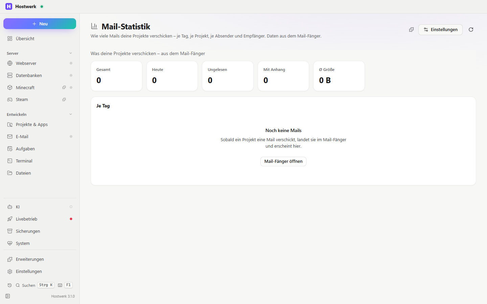

# Mail-Statistik

Wie viele Mails deine Projekte verschicken – je Tag, je Projekt, je Absender und Empfänger. Daten aus dem Mail-Fänger.

[English](README.md) · Offizielle [Hostwerk](https://github.com/Passimoritz/hostwerk-public)-Erweiterung (läuft abgeschottet, ab Hostwerk 2.9)



## Was sie kann

- **Wo:** E-Mail → Statistik – seit 1.3.1 ohne eigenen Seitenleisten-Eintrag; die ganze Seite bleibt unter Erweiterungen → Öffnen
- Mails je Tag als Balken (7, 14 oder 30 Tage)
- Häufigste Projekte (Absender-Domain), Absender und Empfänger
- Kennzahlen: heute, ungelesen, mit Anhang, Durchschnittsgröße
- Klick auf Projekt, Absender, Empfänger oder Tag filtert die ganze Seite (zweiter Klick hebt den Filter auf)
- Warnt, wenn viel mehr Mails als sonst rausgehen – z. B. wenn ein Projekt in einer Schleife verschickt
- Zusätzlich Reiter „Statistik“ in Hostwerks E-Mail-Bereich; die Seite steht in der Leiste bei *E-Mail*
- Kachel für die Übersicht mit der Zahl von heute
- Balken per Tastatur bedienbar und für Bildschirmleser benannt; Datum und Zahlen in der Sprache von Hostwerk
- Ladefehler zeigen eine Meldung mit *Erneut versuchen*; bei verstecktem Reiter wird nicht abgefragt
- Andere Erweiterungen dürfen Reiter ergänzen (`allowExtensions`)

## Installieren

In Hostwerk: **Erweiterungen → Entdecken** → „Mail-Statistik“ → Installieren. Updates kommen von selbst.

## Rechte

- Abgefangene E-Mails lesen (nur Datum, Absender, Empfänger, Größe – Inhalte zeigt die Seite nie)

Seiten laufen abgeschottet (eigener Ursprung, keine fremden Skripte); alles, was etwas ändert, fragt vorher nach.

## Entwickeln

```bash
node --test tests/*.test.js            # Tests der Logik
node pfad/zu/hostwerk-public/sdk/check.js . --strict   # dieselbe Prüfung wie der Katalog
```

Die Logik steckt in `page/lib.js` (ohne DOM, getestet), die Seite in `page/app.js`. Ein Tag `vX.Y.Z` passend zu `manifest.json` veröffentlicht ein Release; der Hostwerk-Katalog übernimmt es.

English: [README.md](README.md) · Lizenz: MIT

## Lizenz

MIT
